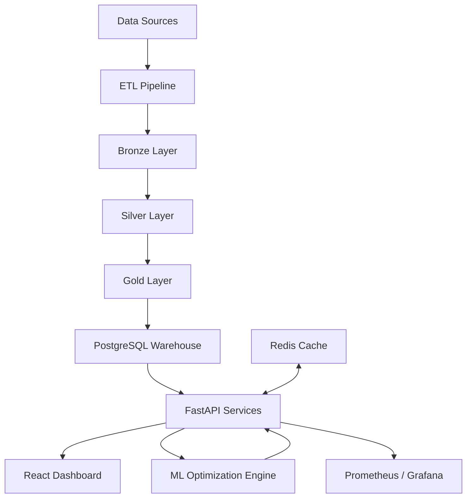

# Warelytics 
### AI-Powered Data Warehouse & Optimization Platform

Warelytics is a full-stack data warehouse platform designed to streamline data ingestion, transformation, monitoring, and optimization. It combines a layered ETL architecture with machine-learning-assisted analytics and a web-based operational dashboard.

The platform uses a **Bronze → Silver → Gold** data processing model, PostgreSQL for persistent storage, FastAPI for backend services, and React for the frontend dashboard.

## Key Capabilities

- **Layered Data Processing:** Organizes data through Bronze, Silver, and Gold warehouse layers.
- **Intelligent Optimization:** Provides ML-assisted recommendations and warehouse performance insights.
- **Operational Analytics:** Tracks workload metrics, storage utilization, system activity, and alerts.
- **Interactive Dashboard:** Offers visual monitoring, analytics, and optimization workflows.
- **Real-Time Communication:** Supports REST APIs and WebSocket-based updates.
- **Caching and Coordination:** Uses Redis for supported caching and coordination workflows.
- **Monitoring Integration:** Supports Prometheus and Grafana for infrastructure observability.

## System Architecture

The platform consists of four primary components:

1. **Frontend:** React and Vite dashboard for monitoring and analytics.
2. **Backend:** FastAPI services responsible for metrics, optimization, and API operations.
3. **Data Infrastructure:** PostgreSQL for warehouse storage and Redis for caching.
4. **ETL Engine:** Processes and transforms data across the warehouse layers.



### Default Development Ports

| Component | Address |
|---|---|
| FastAPI | `http://localhost:8000` |
| API Documentation | `http://localhost:8000/docs` |
| React Dashboard | `http://localhost:5173` |
| PostgreSQL | `localhost:5432` |
| Redis | `localhost:6379` |

The Docker integration configuration may expose different ports, including API gateway port `8000`, ML service port `8001`, and dashboard port `3000`.

## Technology Stack

| Area | Technologies |
|---|---|
| Backend | Python, FastAPI |
| Frontend | React, Vite |
| Database | PostgreSQL |
| Caching | Redis |
| Data Processing | Python ETL |
| Machine Learning | ML optimization models |
| Containerization | Docker, Docker Compose |
| Monitoring | Prometheus, Grafana |
| Workflow Orchestration | Apache Airflow (optional) |

## Prerequisites

Install the following before starting:

- Python 3.10 or newer
- Node.js 18 or newer
- npm
- Docker Desktop or Docker Engine with Compose
- Git (recommended)

PowerShell is useful for running the included Windows helper scripts.

## Getting Started

### 1. Start Infrastructure Services

Open a terminal in the project root and start PostgreSQL and Redis:

```bash
docker compose up -d postgres redis
```

The default database configuration is:

| Setting | Default |
|---|---|
| Database | `datawarehouse` |
| Username | `postgres` |
| Password | `postgres` |
| Host | `localhost` |
| Port | `5432` |

**Security note:** These are development defaults. Configure strong credentials through environment variables before using the system outside a local development environment.

### 2. Install Backend Dependencies

Navigate to the ML optimization service:

```bash
cd ml-optimization
python -m pip install -r requirements.txt
cd ..
```

A Python virtual environment is recommended.

### 3. Launch the Backend

Run the service launcher from the repository root:

```bash
python start_services.py
```

The API should become available at:

- API: `http://localhost:8000`
- Interactive documentation: `http://localhost:8000/docs`

### 4. Launch the Frontend

Open another terminal:

```bash
cd dashboard
npm install
npm run dev
```

Visit:

`http://localhost:5173`

### 5. Configure Environment Variables

Environment templates are provided for the frontend and backend.

- `dashboard/.env.example`
- `ml-optimization/.env.example`

Copy the relevant template into a `.env` file and adjust the settings as required.

## Docker Deployment

NexusFlow Data provides multiple Docker Compose configurations for different deployment scenarios.

### Core Infrastructure

```bash
docker compose up -d postgres redis
```

### Integrated Application Stack

```bash
docker compose -f docker-compose.yml -f docker-compose.integration.yml up --build
```

This configuration includes the integrated application services. Refer to the Compose files for actual service ports and environment settings.

### Monitoring Stack

```bash
docker compose -f docker-compose.yml -f docker-compose.monitoring.yml up -d
```

Grafana is typically accessible on port `3001`.

### Development and Airflow

```bash
docker compose -f docker-compose.yml -f docker-compose.dev.yml up -d
```

The Airflow interface is typically exposed on port `8081`.

## Dashboard Configuration

The dashboard supports the following environment variables:

| Variable | Description |
|---|---|
| `VITE_API_BASE_URL` | Backend REST API base URL |
| `VITE_WS_BASE_URL` | WebSocket server origin |
| `VITE_ANALYTICS_POLL_MS` | Analytics polling interval in milliseconds |

The default API prefix is:

```text
http://localhost:8000/api/v1
```

Check `dashboard/.env.example` for configuration details.

## ETL Processing

The ETL engine follows a three-stage warehouse architecture.

| Layer | Responsibility |
|---|---|
| Bronze | Stores ingested source data |
| Silver | Handles cleaning and transformation |
| Gold | Produces structured, analytics-ready datasets |

**Main execution script:**

```text
etl/scripts/run_etl.py
```

Additional utilities include:

- `etl/scripts/run_etl_cron.ps1` — Windows scheduled execution.
- `etl/scripts/etl_pipeline.log` — ETL execution logs, when file logging is enabled.
- `infrastructure/docker/postgres/init-scripts/` — Database initialization scripts.

Ensure PostgreSQL and the required schemas are initialized before running the ETL pipeline.

## Project Structure

```text
Warelytics/
│
├── ml-optimization/
│   ├── api/
│   ├── models/
│   ├── routes/
│   └── requirements.txt
│
├── dashboard/
│   ├── src/
│   ├── public/
│   └── package.json
│
├── api-gateway/
│
├── etl/
│   ├── scripts/
│   └── dags/
│
├── infrastructure/
│   └── docker/
│
├── scripts/
│
├── start_services.py
├── docker-compose.yml
├── docker-compose.integration.yml
├── docker-compose.monitoring.yml
└── docker-compose.dev.yml
```

This is a high-level overview; the actual repository structure remains authoritative.

## Troubleshooting

**Dashboard cannot reach the API**

- Confirm that the backend is running.
- Check `VITE_API_BASE_URL`.
- Verify that the configured API port and `/api/v1` prefix are correct.

**WebSocket connection failures**

- Verify `VITE_WS_BASE_URL`.
- Check the backend CORS and WebSocket configuration.

**PostgreSQL connection errors**

- Confirm that the database container is running.
- Check port `5432`.
- Verify the database credentials and initialization scripts.

**Windows event-loop issues**

Use the recommended root-level launcher:

```bash
python start_services.py
```

## Development Notes

- Use environment variables for application configuration.
- Avoid committing secrets or local environment files.
- Review Docker Compose configurations before deployment.
- Run tests before submitting code changes.
- Keep database initialization and migration procedures consistent.

---

**Warelytics Data** — A unified platform for data engineering, warehouse analytics, and intelligent optimization.